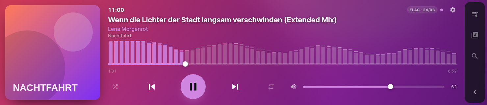
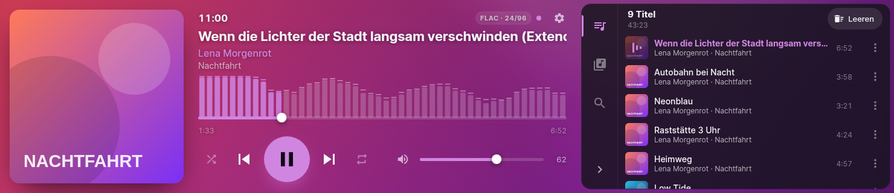
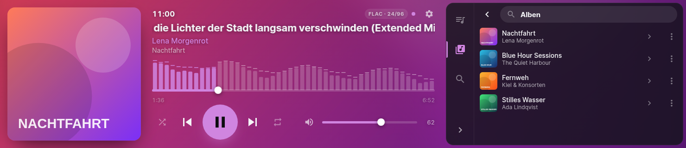
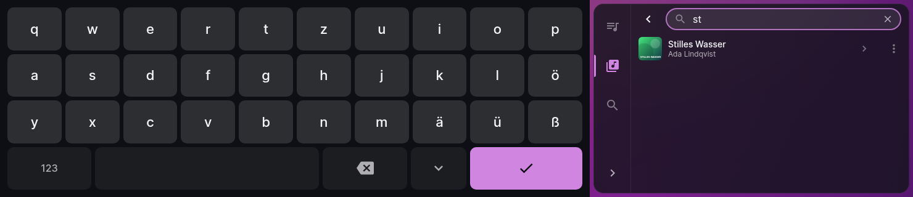
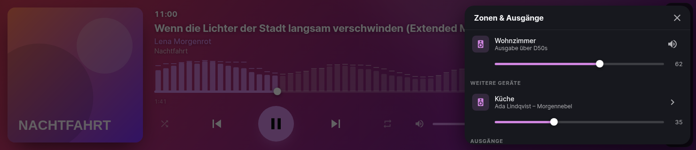
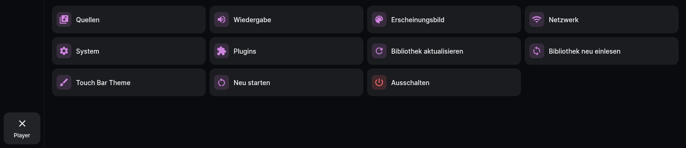
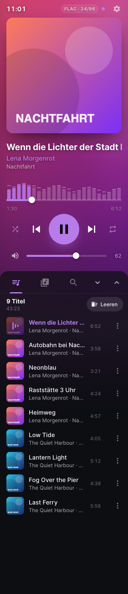
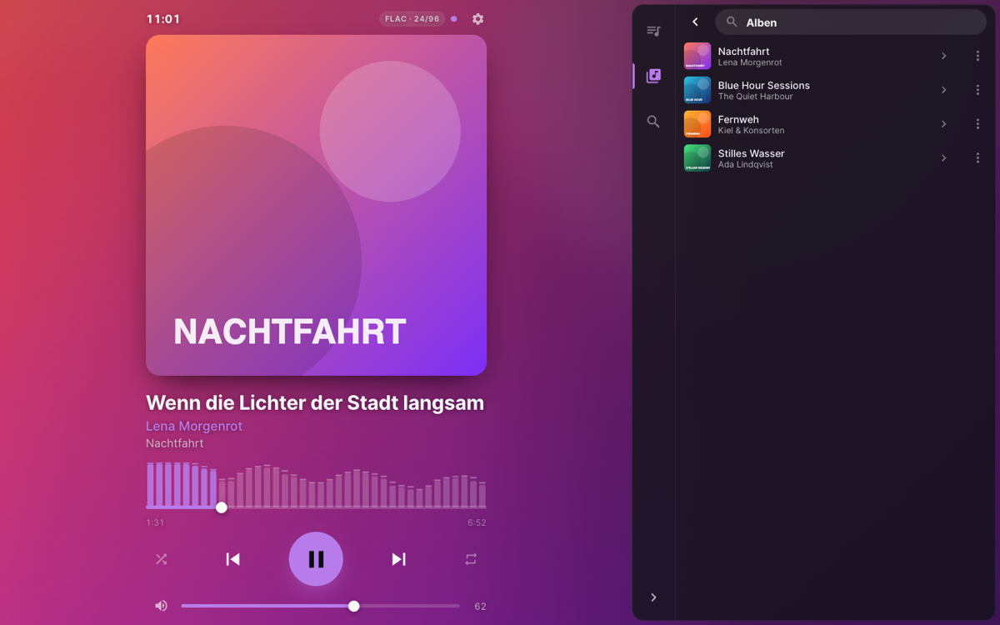

# Touch Bar Theme für Volumio

Eine Touch-Oberfläche für **Volumio 3/4** auf schmalen Bar-Displays wie **320×1480** – im
Querformat (1480×320) wie im Hochformat (320×1480). Sie passt sich auch an ähnliche Displays an
(z. B. 400×1280), läuft am Computer und auf Tablets und bringt einen **Band-Analyzer** mit, der
für jede Audioquelle funktioniert.

[English version](README.md)



<sub>Alle Geräte-Screenshots wurden auf einem Raspberry Pi 5 mit Volumio 4 in der nativen
Auflösung 1480×320 erzeugt, im eingebauten Demo-Modus (erzeugte Cover, keine echte Bibliothek).</sub>

## Screenshots

| | |
| --- | --- |
|  |  |
| Warteschlange im Seitenpanel | Bibliothek mit Albenliste |
|  |  |
| Live-Filter mit Bildschirmtastatur | Zonen & Ausgänge |
|  |  |
| Volumio-Einstellungen, Bibliothek, Neustart | Ruhebildschirm |

<table>
  <tr>
    <td width="22%"></td>
    <td></td>
  </tr>
  <tr>
    <td>Hochformat (320×1480)</td>
    <td>Browser am Computer unter <code>http://volumio.local</code></td>
  </tr>
</table>

## Funktionen

- **Player** – großes Cover, Titel mit Laufschrift, Qualitätsanzeige (`FLAC · 24/96`),
  Positionsregler zum Ziehen, große Tasten (Play 76 px, alles andere ≥ 44 px), Zufall,
  Wiederholen (aus → alle → einer), Lautstärke
- **Band-Analyzer** – 64 Frequenzbänder (35 Hz–16 kHz) des echten Audiosignals hinter dem
  Positionsregler, für **jede Quelle**: Bibliothek, Webradio, AirPlay, Spotify, Bluetooth … Der
  gespielte Teil leuchtet in der Akzentfarbe
- **Gesten** – Cover nach links/rechts wischen für nächsten/vorherigen Titel; langes Drücken
  (oder ⋮) auf einen Eintrag öffnet das Aktionsmenü direkt neben dem Finger
- **Warteschlange, Bibliothek und Suche** in einem einklappbaren Seitenpanel (nur Symbole,
  Beschriftung optional); jede Bibliotheksliste hat einen **Live-Filter**, der Akzente ignoriert
  („beyonce“ findet „Beyoncé“)
- **Bildschirmtastatur** passend zum Bar-Display (QWERTZ über dem Player im Querformat,
  alphabetisch mit 7 Spalten im Hochformat); am Computer tippt man auf der echten Tastatur
- **Zonen & Ausgänge** hinter dem Lautsprecher-Symbol – dieses Gerät, weitere Volumio-Geräte im
  Netzwerk und zuschaltbare Ausgänge, jeweils mit eigener Lautstärke
- **Volumio-Einstellungen** hinter dem Zahnrad – Quellen, Wiedergabe, Erscheinungsbild, Netzwerk,
  System, Plugins, Bibliothek aktualisieren/neu einlesen, Neustart und Herunterfahren. Volumios
  eigene Seiten werden eingebettet
- **Akzentfarbe** aus dem Albumcover; unscharfer Cover-Hintergrund
- **Erreichbar unter `http://volumio.local`** – Volumios eigene Oberfläche bleibt unter
  `http://volumio.local:3000`
- **Ruhebildschirm** mit gedimmter, mittiger Uhr, wenn nichts läuft
- Kiosk-tauglich: kein Mauszeiger, kein Zoom, kein Kontextmenü, kein Überscrollen
- Kein Build-Schritt, keine Laufzeit-Abhängigkeiten außer Volumios üblichen `kew` und `v-conf`

## Voraussetzungen

- Volumio 3 oder 4 (getestet mit **Volumio 4.231**, Raspberry Pi 5, 320×1480-DSI-Display im
  Querformat)
- Das offizielle **Touch-Display**-Plugin für den lokalen Bildschirm (dort wird auch die Drehung
  eingestellt)
- Vorgebaute Analyzer-Bibliotheken für `armhf` (alle Raspberry Pis mit dem üblichen 32-Bit-Image),
  `arm64` und `x64`

## Installation

1. SSH auf dem Volumio-Gerät aktivieren (`http://volumio.local:3000/dev` → SSH).
2. Das Plugin samt `node_modules` auf das Gerät kopieren:
   ```sh
   git clone https://github.com/deckerjulian/volumio-touch-bar-theme.git
   cd volumio-touch-bar-theme
   npm install --omit=dev
   scp -r . volumio@volumio.local:/home/volumio/touch_bar_theme
   ```
3. Auf dem Gerät installieren:
   ```sh
   ssh volumio@volumio.local
   cd ~/touch_bar_theme
   volumio plugin install
   ```
4. Unter *Plugins → Installierte Plugins* **Touch Bar Theme** aktivieren. Das Display wechselt
   automatisch auf das Theme.

Für Updates die neuen Dateien kopieren und auf dem Gerät `volumio plugin update` ausführen.

## Einstellungen

| Einstellung | Standard | Bedeutung |
| --- | --- | --- |
| Auf dem Touch-Display verwenden | an | Der Kiosk zeigt das Theme statt der Volumio-Oberfläche |
| Theme unter volumio.local anzeigen | an | Port 80 zeigt das Theme, Volumio bleibt auf Port 3000 |
| Port | 4005 | Port des Theme-Webservers |
| Akzentfarbe | aus dem Cover | oder eine feste Farbe |
| Feste Farbe / Ersatzfarbe | `#3ddc97` | auch, wenn sich aus dem Cover keine Farbe ermitteln lässt |
| Hintergrund | unscharfes Cover | „Schlicht dunkel“ schont schwache Hardware |
| Laufschrift | an | lange Titel laufen durch statt abgeschnitten zu werden |
| 24-Stunden-Uhr | an | |
| Beschriftung der Menüsymbole | aus | Namen unter den Panel-Symbolen |
| Band-Analyzer | an | wirkt ab dem nächsten Start der Wiedergabe |
| Analyzer-Verzögerung Bibliothek & Webradio | 0 ms | nur nötig, falls die Balken dem Ton vorauslaufen |
| Analyzer-Verzögerung AirPlay, Spotify & Co. | 0 ms | eigener Wert für Quellen außerhalb von MPD |
| Eingebaute Bildschirmtastatur | an | nur auf Touch-Geräten |
| Mauszeiger ausblenden | an | nur im Kiosk |
| Ruhebildschirm nach | 300 s | 0 = aus |

Änderungen am Aussehen übernimmt das Display innerhalb von 20 Sekunden ohne Neustart.

## Funktionsweise

| Pfad | Zweck |
| --- | --- |
| `index.js` | Volumio-Plugin: Lebenszyklus, Einstellungen, Kiosk, Port 80, Analyzer |
| `lib/server.js` | Kleiner Webserver (nur Node-Bordmittel); reicht `/albumart` usw. an Volumio durch |
| `lib/kiosk.js` | Stellt den Kiosk des Touch-Display-Plugins auf das Theme um und zurück |
| `lib/port80.js` | systemd-Ergänzung, die Port 80 auf das Theme umleitet |
| `lib/spectrum.js`, `lib/spectrum-worker.js` | Liest den Analyzer-FIFO, FFT, Server-Sent Events |
| `alsa/touchbar_scope.c`, `alsa/lib/*` | ALSA-`meter`-Scope und vorgebaute Bibliotheken |
| `app/` | Die Oberfläche (HTML/CSS/JS), spricht per Socket.IO mit Volumio |
| `app/demo.js` | Simuliertes Volumio für den Demo-Modus |

### Änderungen am System

Alle werden beim Deaktivieren oder Deinstallieren des Plugins zurückgenommen.

- **Kiosk**: ersetzt `http://localhost:3000` in `/opt/volumiokiosk.sh` durch die Theme-URL.
- **Port 80**: legt `/etc/systemd/system/iptables.service.d/touchbar.conf` an, damit Volumios
  vorhandene Umleitung von Port 80 auf das Theme statt auf Port 3000 zeigt.
- **Analyzer**: trägt über Volumios offizielle Schnittstelle (`has_alsa_contribution`) einen
  ALSA-Baustein ein: `volumio → touchbar_meter → volumioOutput`. ALSAs `meter` reicht den Ton
  unverändert weiter; der Scope kopiert ihn in einen FIFO und verwirft Daten, statt die Wiedergabe
  jemals zu blockieren. Vor dem Einbau wird die Bibliothek in einer abgeschotteten Testkette
  (Ausgabe ins Leere) geladen; schlägt das fehl, bleibt die Audiokette unverändert. Weil `meter`
  dem Hardware-Zeiger des DAC folgt, laufen die Balken ohne Verzögerung synchron zum Ton.

## Entwicklung

```sh
npm install
npm test                            # Smoke-Test (Webserver, Pfadschutz, Kiosk-Ersetzung)
npm run dev                         # http://localhost:4005/?demo – ohne Volumio
VOLUMIO=volumio.local npm run dev   # gegen ein echtes Volumio im Netzwerk
npm run build-alsa                  # ALSA-Scope für alle Architekturen bauen (braucht Docker)
```

Im Browser die Geräteemulation auf 1480×320 oder 320×1480 stellen. URL-Parameter: `demo`,
`volumio=http://host:3000`, `accentMode=fixed`, `accentColor=%23ff8800`, `background=solid`.

## Fehlerbehebung

- **Drehencoder oder GPIO-Taster reagieren nach `systemctl restart volumio` nicht mehr**:
  GPIO-Plugins wie *Rotary Encoder II* räumen ihre Device-Tree-Overlays dabei nicht auf. Den Pi neu
  starten (oder das Plugin aus- und wieder einschalten).
- **`https://volumio.local` öffnet das Theme nicht**: Volumio hat kein HTTPS, `http://` verwenden.
- **Keine Analyzer-Balken**: Plugin-Log prüfen (`journalctl -u volumio | grep touch_bar`). Ist der
  Ladetest fehlgeschlagen, bleibt der Analyzer aus, die Wiedergabe ist nicht betroffen.

## Lizenz

MIT, siehe [LICENSE](LICENSE). Mitgeliefert: Schrift Inter (SIL OFL 1.1, `app/fonts/OFL.txt`) und
Pfade der Material-Design-Icons (Apache 2.0).
